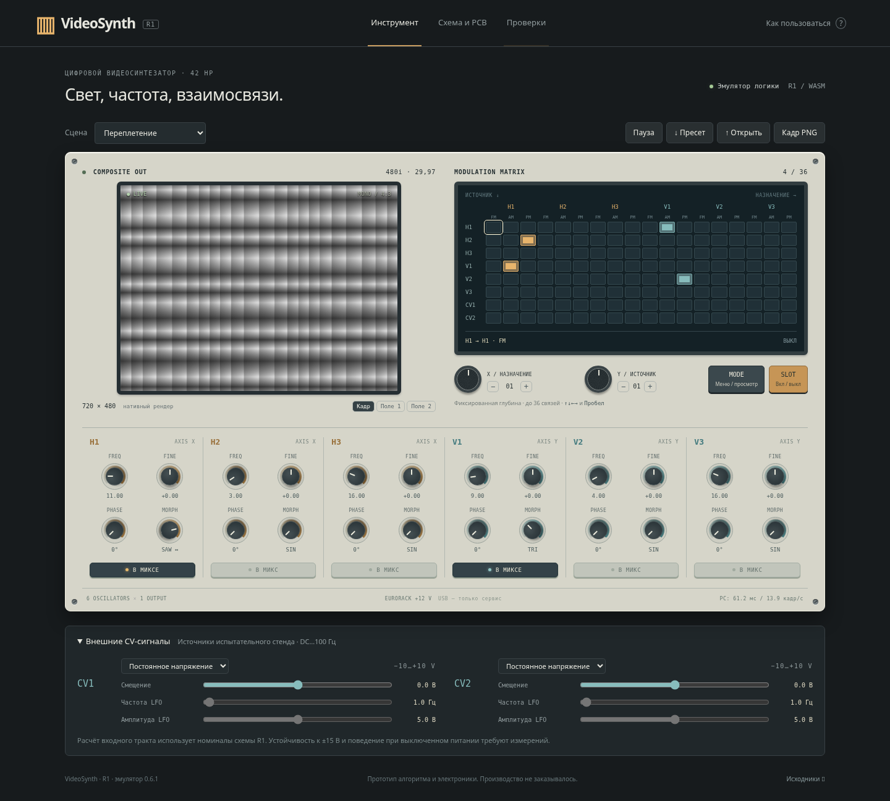

# VideoSynth

**R1: схемы и две разведённые PCB KiCad 9, визуальный эмулятор и результаты проверок.** Один монохромный выход 480i, шесть осцилляторов, экранная матрица до 36 связей, два CV DC…100 Гц, Eurorack 42 HP, модуль ESP32-P4.

- [Начать с обзора R1](docs/r1/README.md)
- [Скачать автономный эмулятор HTML](https://raw.githubusercontent.com/Guadonna/VideoSynth/main/dist/VideoSynth-R1.html) — сохраните файл и откройте в браузере
- [Основная схема PDF](hardware/kicad/core/core-schematic.pdf) / [схема панели PDF](hardware/kicad/panel/panel-schematic.pdf)
- [Проекты KiCad и PCB](hardware/kicad/) / [полный архив R1](dist/VideoSynth-R1-prototype.zip)
- [Проверки и ограничения](docs/r1/validation.md)
- [BOM](hardware/bom-r1.csv) / [смета](hardware/cost-estimate-usd.csv) / [испытания прототипа](docs/r1/bringup.md)



## Запуск приложения

Нужен Node.js 20+. Готовый WASM включён в репозиторий; для самого приложения установка пакетов не нужна.

```sh
npm start
```

Сервер слушает порт 4173; приложение находится по пути `/app/index.html`. В облачной среде используйте предпросмотр порта 4173. Можно также открыть скачанный `dist/VideoSynth-R1.html` без сервера: код, изображения плат и WASM встроены в файл.

**Эмулятор 0.6.1:** исправлен пустой экран с «Ошибка DSP: undefined». Фоновый DSP использует обычный Worker; если браузер не может его запустить, автоматически включается совместимый режим с тем же WASM. Скачайте обновлённый HTML вместо старого файла; версия указана внизу страницы. [Подробности исправления и проверки](docs/r1/emulator-fixes.md).

Для тестов нужны C-компилятор и зависимости разработки:

```sh
npm ci
npm test
npm run test:browser
npm run test:spice
```

Браузерный тест запускается при работающем сервере; ему нужен Chromium (`CHROMIUM=/путь/к/chromium`). SPICE использует `libngspice`. [Полное воспроизведение сборки и CAD-проверок](docs/r1/validation.md).

R1 — инженерный прототип. Нулевые ERC/DRC и программная эмуляция не подтверждают реальный видеосигнал, устойчивость CV и скорость ESP32-P4. Готовой прошивки платы пока нет. Изготовление не заказывалось.

## История исследования

Документы прежних этапов сохранены без изменения исторических выводов:

- [ТЗ v0.4](docs/requirements/video_synth_TZ_v0.4.md), [исследование v0.4](docs/feasibility-v0.4.md)
- [ТЗ v0.5](docs/requirements/video_synth_TZ_v0.5.md), [исследование v0.5](docs/feasibility-v0.5.md), [выжимка](docs/summary-v0.5.md)

Новый запрос пользователя разрешил схему и PCB, готовый модуль ESP32-P4 и 42 HP. Численные правила модуляции R1 описаны отдельно как инженерные допущения, а не как ранее согласованные требования.
