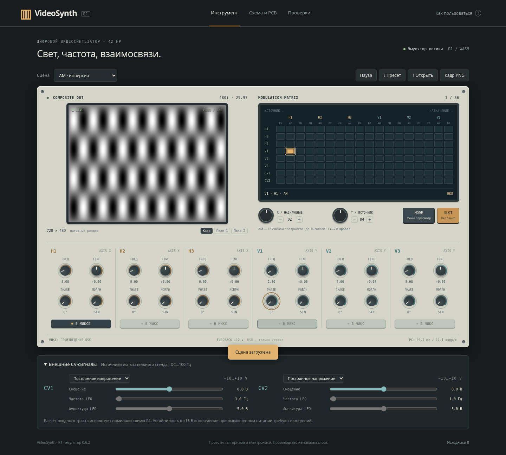
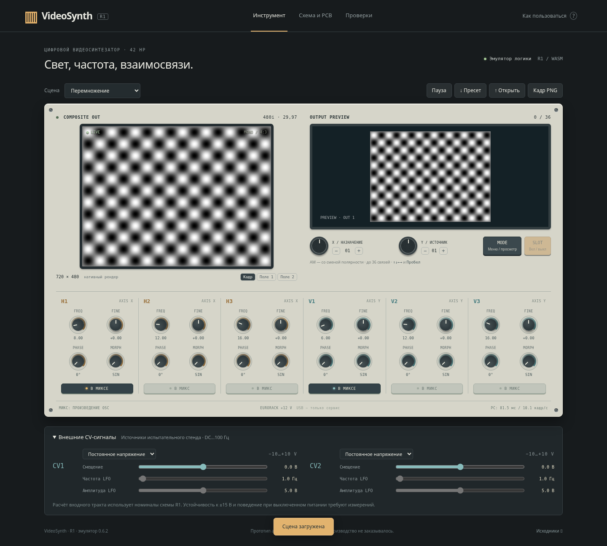

# Перемножение и кольцевая AM — эмулятор 0.6.2

Пользователь заметил слабое действие AM и усреднение изображений в миксе. После уточнения выбраны **перемножение сигналов в миксе** и **AM с изменением полярности**. Исправлены общее ядро C, собранный из него WASM, сцены приложения и автономный HTML.

## Причины прежнего поведения

В 0.6.1 одна AM-связь давала усиление `1 + 0,25 × source`: всего 0,75…1,25, без возможности смены знака. Верхняя часть дополнительно ограничивалась до +1. При управляющем CV −10 В тестовая синусоида всё ещё занимала уровни яркости **32…223** — несущая оставалась хорошо видна.

Микс вычислял среднее яркостей выбранных OSC. Проверка двух одинаковых синусоид дала побитовое совпадение с одним OSC: например, контрольный пиксель оставался **176 → 176**. Это не соответствовало выбранному пользователем произведению.

## Новое поведение

- **AM:** выход OSC умножается на биполярный управляющий сигнал −1…+1. +1 сохраняет его, −1 инвертирует, 0 убирает переменную составляющую. Без активных AM-связей OSC проходит без изменения. Несколько AM-источников складываются с ограничением ±1; это явно выбранное инженерное правило одной управляющей шины.
- **Микс:** включённые кнопками OSC перемножаются в биполярном диапазоне; лишь затем произведение переводится в яркость. Два одинаковых сигнала дают `x²`, противоположные — `−x²`. OSC, исключённый из микса, по-прежнему может модулировать другие.
- **Ноль сигнала означает средний серый.** При отсутствии всех выбранных OSC по-прежнему выводится чёрный кадр с синхронизацией. При нескольких синусоидах контраст произведения может уменьшаться; скрытого автоматического усиления нет.
- Добавлены сцены **«Перемножение»** и **«AM · инверсия»**. В последней только H1 включён в микс, а невидимый V1 подключён к его AM. Выделенный SLOT позволяет сравнить эффект с исходной несущей.
- «Переплетение» и «36 связей» изменены для нового закона. Замкнутая AM-группа при нулевой истории может остаться на нуле: в демонстрациях предусмотрены источники без входящей AM. Старые JSON-пресеты версии 1 читаются, но их изображение меняется; искусственное возбуждение AM-петель не добавлялось.

[Полные формулы, порядок обработки и ограничения](dsp.md).

## Проверка

**32 автоматических теста**, **13 браузерных сценариев**, **7 сценариев совместимости запуска**, **10 встроенных самопроверок** проходят. В C/WASM проверены знаки, нулевой множитель, отключение связей, все шесть множителей, обе фазы чересстрочного растра и обратная связь. В браузере реальные пиксели сравниваются с аналитическим произведением синусоид; проверены кнопки, фаза, SLOT и CV. Повторно проверены оба canvas, Worker и совместимый режим, автономный HTML без внешних ресурсов. [Отчёты и измерение производительности](validation.md).

Это проверка цифровой модели умножителя. Работоспособность физического видеотракта и скорость ESP32-P4 требуют испытаний. Прямую навигацию `file://` по-прежнему блокирует политика облачного Chromium; проверены автономный документ с opaque origin и отказ Worker, а не конкретная установка Chrome пользователя.

Скачайте новый **dist/VideoSynth-R1.html**, замените старую копию и проверьте номер **0.6.2** внизу страницы. Исправление восстановления DSP из 0.6.1 включено в эту сборку.
